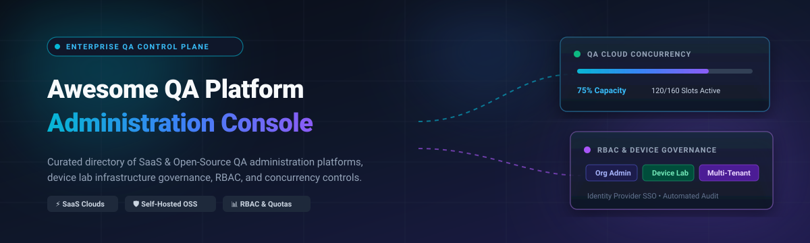

# Awesome-QA-Platform-Administration-Console

  

# 🚀 Awesome QA Platform Administration Console

> 🎯 A curated list of top **QA Platform Administration Console** platforms — both SaaS/hosted commercial device cloud admin portals and open-source alternatives for managing users, teams, devices, and access governance across automated testing infrastructure.
>
> 🌟 Star this repo if you find it useful! 🌟

---

## 📑 Table of Contents

- [📈 Sector Overview & Market Dynamics](#-sector-overview--market-dynamics)
- [🟦 SaaS / Hosted Platforms](#-saas--hosted-platforms)
  - [SaaS Platforms Comparison Table](#-saas-platforms-comparison-table)
  - [Sauce Labs Admin](#sauce-labs-admin)
  - [Perfecto Console](#perfecto-console)
  - [Kobiton Portal](#kobiton-portal)
  - [Cypress Cloud Admin](#cypress-cloud-admin)
- [🟩 Open-Source Software](#-open-source-software)
  - [Open-Source Platforms Star Ranking](#-open-source-platforms-star-ranking)
  - [DeviceFarmer / STF](#devicefarmer--stf)
  - [ReportPortal](#reportportal)
  - [Testkube](#testkube)
  - [TestLink](#testlink)
  - [Kiwi TCMS](#kiwi-tcms)
  - [QA Studio](#qa-studio)
  - [noob-test-manager](#noob-test-manager)
  - [Punchlist QA](#punchlist-qa)
  - [testrarc](#testrarc)
- [📊 Architectural Comparison at a Glance](#-architectural-comparison-at-a-glance)
- [🔍 SEO & Industry Keywords](#-seo--industry-keywords)
- [🤝 Contributing](#-contributing)
- [📄 License](#-license)

---

## 📈 Sector Overview & Market Dynamics

The global software testing and QA platform market is estimated at **$54B–$66B** (expanding toward **$120B+** at an **8%–12% CAGR**), driven by rapid CI/CD adoption, shift-left testing, and AI-augmented test automation suites. The sector exhibits **moderate-to-high fragmentation**: while foundational infrastructure is anchored by prominent DevOps leaders and private-equity-backed conglomerates, the market lacks a single "winner-take-all" monopolist due to distinct operational splits between mobile device clouds, browser execution grids, API testing hubs, and Kubernetes-native test runners.

---

## 🟦 SaaS / Hosted Platforms

Commercial, cloud-hosted QA Platform Administration Console platforms providing enterprise-grade multi-tenancy, concurrency scheduling, and compliance controls.

### 📊 SaaS Platforms Comparison Table

*Sorted descending by company size (Valuation / Estimated Enterprise Scale).*

| Platform | Company Size (Valuation / Scale) | Starting Tier Pricing | Free Tier / Free Trial Limits | Key Administrative & Console Capabilities |
| :--- | :--- | :--- | :--- | :--- |
| **[Perfecto](https://www.perfecto.io/)** (Perforce Software) | **~$2B+ Valuation** (~$600M+ ARR via Clearlake Capital & Francisco Partners) | **$300/mo** (entry manual/automation testing tiers, custom-quoted enterprise packages) | **14-day free trial** (access to real-device cloud sandbox and manual/automation test execution) | Org groups, legacy granular permission matrix (`INTERACTIVE`, `AUTOMATION`, `USER_ADMINISTRATOR`), dedicated private device clouds, and AI scriptless execution. |
| **[Sauce Labs](https://saucelabs.com/)** | **~$613M Valuation** (~$92M ARR, $270M+ total venture funding) | **$39/mo** (Live Testing; Virtual Cloud starts at $149/mo, Real Device Cloud at $199/mo) | **28-day free trial** (limited to 60 combined live/automated testing minutes, max 3 parallel VMs, and 50 AI queries) | Centralized Organization Management, team VM concurrency caps (e.g., 60 VMs/team), multi-team user isolation, and service account deletion safeguards. |
| **[Kobiton](https://kobiton.com/)** | **~$40.1M Raised** (~$27.3M ARR, Series B) | **$83/mo** (Startup plan; Accelerate at $399/mo, Scale at $9,000/yr) | **15-day free trial** (capped at 300 real-device testing minutes on public device clouds) | Predefined and custom RBAC (`Owner`, `Admin`, `Member`), granular module permissions across device pools, session logs, and team assignments. |
| **[Cypress Cloud](https://www.cypress.io/)** | **~$43.3M+ Valuation** (~$17.8M ARR, $63M raised) | **$67/mo** (Team tier, billed annually; Business tier starts at $267/mo) | **Free Forever plan** (50 users, 500 monthly test recordings, basic AI features; plus unlimited for open-source OSS projects) | Organization-wide control plane, centralized Cloud AI feature toggling, team project access boundaries, internet visibility controls, and unified billing rollups. |

---

### Sauce Labs Admin
- **🏢 Provider:** Sauce Labs
- **🎯 Type:** Organization, team, and concurrency administration  
- **💰 Pricing:** Starts at **$39/month** (Live Testing); Virtual Device Cloud at **$149/month**; Real Device Cloud at **$199/month**.
- **🎁 Free Plan / Trial:** **28-day free trial** (includes 60 combined live/automated testing minutes, 3 parallel VMs, and 50 AI analytical queries).
- **🔑 Key Administrative Capabilities:**
  - **Team creation** with line-of-business association and **team VM concurrency limits** (e.g., 60 concurrent VMs per team)
  - **Team membership management**: members can access projects belonging to their teams, with **Team Admin** roles able to invite users and set team roles
  - **User assignment**: a user can only be assigned to one team, and changing assignment removes the previous association
  - **Deletion safeguards**: teams containing service accounts cannot be deleted; teams with only user accounts can be deleted with member reassignment
- **🏆 Best for:** Enterprises needing structured team isolation with concurrency governance and clear role hierarchies for testing infrastructure.

### Perfecto Console
- **🏢 Provider:** Perforce Software
- **🎯 Type:** Device lab administration with roles and org groups  
- **💰 Pricing:** Entry packages start around **$300/month**; enterprise tiered concurrency quotes.
- **🎁 Free Plan / Trial:** **14-day free trial** with real-device cloud sandbox access.
- **🔑 Key Administrative Capabilities:**
  - **Org groups** for organizing users by manager, project, or team (privileges controlled by granular roles)
  - **Standard roles** include Administrator (full lab privileges) and Handset Viewer (manual/automated testing, view/stop executions)
  - **Legacy role matrix** covers granular permissions like `INTERACTIVE`, `AUTOMATION`, `ADVANCED_AUTOMATION`, `HANDSET_ADMINISTRATOR`, `USER_ADMINISTRATOR`, and more
  - **Device management** via the Devices view, available in private clouds
- **🏆 Best for:** Private cloud and enterprise device lab administrators needing granular role-based access with device-level control.

### Kobiton Portal
- **🏢 Provider:** Kobiton, Inc.
- **🎯 Type:** Organization management with predefined and custom RBAC  
- **💰 Pricing:** Starts at **$83/month** (Startup plan); Accelerate plan at **$399/month**; Scale at **$9,000/year**.
- **🎁 Free Plan / Trial:** **15-day free trial** with up to **300 testing minutes** on real public devices.
- **🔑 Key Administrative Capabilities:**
  - **Predefined roles**: Organization Owner (all permissions, transferable), ADMIN (all permissions + device management), and MEMBER (basic login and app view)
  - **Granular permissions** across categories including App Repo, Devices, Org Management, Settings, Sessions, and Subscriptions
  - **Team management** for grouping users with shared permissions
  - **User role assignment** required for all users (at least one role per user)
- **🏆 Best for:** Teams needing a clear predefined role hierarchy with granular permission categories for device cloud administration.

### Cypress Cloud Admin
- **🏢 Provider:** Cypress.io
- **🎯 Type:** Organization-level administration with centralized AI and security controls  
- **💰 Pricing:** Starter at **$0/month**; Team tier starts at **$67/month**; Business tier starts at **$267/month**.
- **🎁 Free Plan / Trial:** **Free Forever Starter Tier** (up to 50 users, 500 test results/month) + **Free OSS Plan** with unlimited recordings for public open-source repositories.
- **🔑 Key Administrative Capabilities:**
  - **User and team management** with roles granting access to specific projects, enabling multiple business units to share one organization
  - **Centralized Cloud AI toggle**: organization admins and owners can enable or disable AI capabilities (test authoring, error summaries, test analysis) for the entire organization
  - **Member privileges**: control whether non-admin members can create public projects (visible to anyone on the internet)
  - **Billing and usage** rollup across all projects for capacity planning and spend attribution
- **🏆 Best for:** Modern engineering organizations wanting centralized governance of CI/CD test orchestration, security, billing, and team access.

---

## 🟩 Open-Source Software

Self-hosted, community-driven QA Platform Administration Console tools and test infrastructure management planes.

### 🌟 Open-Source Platforms Star Ranking

*Sorted descending by GitHub star count.*

| Platform | Stars | Tech Stack | License | Primary Focus |
| :--- | :--- | :--- | :--- | :--- |
| **[DeviceFarmer / STF](https://github.com/DeviceFarmer/stf)** |  | Node.js / RethinkDB / ZeroMQ | Apache-2.0 | Remote Android device farm management & browser console |
| **[ReportPortal](https://github.com/reportportal/reportportal)** |  | Java / Spring / React / PostgreSQL | Apache-2.0 | Enterprise AI-powered centralized test ops & analytics hub |
| **[Testkube](https://github.com/kubeshop/testkube)** |  | Go / Kubernetes / React | MIT | Kubernetes-native test execution control plane & dashboard |
| **[TestLink](https://github.com/TestLinkOpenSourceTRMS/testlink-code)** |  | PHP / MariaDB / Apache | GPL-2.0 | Classical requirement & test management administrative system |
| **[Kiwi TCMS](https://github.com/kiwitcms/kiwitcms)** |  | Python / Django / Patternfly | GPL-3.0 | Comprehensive enterprise test management system with full RBAC |
| **[QA Studio](https://github.com/QAStudio-Dev/studio)** |  | SvelteKit / PostgreSQL / Prisma | AGPL-3.0 | Lightweight API-first modern test case management & team invites |
| **[noob-test-manager](https://www.npmjs.com/package/@ai-sdet/test-manager)** |  | Node.js / SQLite / CLI | Open Source | Self-hosted CLI test runner with automatic super admin setup |
| **[Punchlist QA](https://github.com/bradtaylorsf/punchlist-qa)** |  | Node.js / PostgreSQL / Docker | MIT | Multi-repo QA testing dashboard and support widget toolkit |
| **[testrarc](https://git.resf.org/testing/testrarc)** |  | Python / Rio Web Framework | Open Source | Linux distribution release candidate QA tracker & lead RBAC |

---

### DeviceFarmer / STF 
- **🛠️ Stack:** Node.js / RethinkDB / ZeroMQ | **📜 License:** Apache-2.0  
- **🌐 Repository:** [DeviceFarmer/stf](https://github.com/DeviceFarmer/stf)
- DeviceFarmer STF (Smartphone Test Farm) is the primary maintained community continuation of OpenSTF, providing browser-based remote control, diagnostics, and management for fleets of real Android devices.
- **🔑 Key Administrative Features:**
  - **Centralized Device Control Console:** Interactive real-time device screen streaming and debug command execution via browser.
  - **User & Device Allocation:** Device reservation and exclusivity locks preventing concurrent conflicts between QA testers.
  - **LDAP & Mock Authentication:** Pluggable auth modules to configure enterprise single-sign-on or organization login policies.
- **🏆 Best for:** In-house QA infrastructure teams maintaining on-premise mobile device hardware racks.

### ReportPortal 
- **🛠️ Stack:** Java / Spring Boot / React / PostgreSQL | **📜 License:** Apache-2.0  
- **🌐 Repository:** [reportportal/reportportal](https://github.com/reportportal/reportportal)
- ReportPortal is an enterprise-grade AI-powered test automation analytics and centralized execution dashboard.
- **🔑 Key Administrative Features:**
  - **Multi-Tenant Project Isolation:** Create, manage, and assign independent projects with distinct member access privileges.
  - **Role-Based Access Control:** Predefined roles (`Admin`, `Project Lead`, `Member`, `Operator`) for strict governance.
  - **Centralized Integration Management:** Configure Jira, Rally, GitLab, and email notification integrations centrally across test suites.
- **🏆 Best for:** Enterprise QA departments seeking a unified administrative reporting console across disparate test frameworks.

### Testkube 
- **🛠️ Stack:** Go / Kubernetes CRDs / React | **📜 License:** MIT  
- **🌐 Repository:** [kubeshop/testkube](https://github.com/kubeshop/testkube)
- Testkube is a Kubernetes-native test execution control plane that turns your cluster into an integrated testing grid.
- **🔑 Key Administrative Features:**
  - **Cluster-Native Management:** Native Custom Resource Definitions (CRDs) for orchestrating Cypress, Playwright, Postman, and k6 suites.
  - **Centralized Test Dashboards:** Visual dashboard for configuring execution triggers, environment artifacts, and historical runs.
  - **Role & Access Governance:** Native Kubernetes RBAC alignment and team separation for testing resources.
- **🏆 Best for:** Cloud-native engineering teams running automated tests directly inside Kubernetes infrastructure.

### TestLink 
- **🛠️ Stack:** PHP / MariaDB / Apache | **📜 License:** GPL-2.0  
- **🌐 Repository:** [TestLinkOpenSourceTRMS/testlink-code](https://github.com/TestLinkOpenSourceTRMS/testlink-code)
- TestLink is a longstanding web-based test and requirement management system with comprehensive administrative tooling.
- **🔑 Key Administrative Features:**
  - **Granular User Roles:** Default system roles (`Guest`, `User`, `Senior Tester`, `Test Designer`, `Leader`, `Admin`) with individual permission flags.
  - **Test Project Management:** Independent project permissions, versioning, and test suite baseline governance.
  - **Inventory Tracking:** Basic hardware/software test bed assignment to test execution plans.
- **🏆 Best for:** Teams requiring a time-tested, self-hosted requirement traceability and manual test case admin system.

### Kiwi TCMS 
- **🛠️ Stack:** Python / Django / PostgreSQL | **📜 License:** GPL-3.0  
- **🌐 Repository:** [kiwitcms/kiwitcms](https://github.com/kiwitcms/kiwitcms)
- Kiwi TCMS is a leading open-source test case management system with millions of downloads and deep enterprise integration.
- **🔑 Key Administrative Features:**
  - **Django RBAC Architecture:** Group-based permission sets, granular object-level rights, and audit trails.
  - **Tenant & Team Management:** Structured isolation across products, versions, test plans, and environments.
  - **Plugin Ecosystem:** Centralized management of bug tracking integrations (GitHub, Jira, Bugzilla, GitLab).
- **🏆 Best for:** QA teams seeking an actively maintained, highly customizable open-source test management console.

### QA Studio 
- **🛠️ Stack:** SvelteKit / PostgreSQL / Prisma | **📜 License:** AGPL-3.0  
- **🌐 Repository:** [QAStudio-Dev/studio](https://github.com/QAStudio-Dev/studio)
- QA Studio is a modern open-source test management platform with self-hosted authentication and a REST API.
- **🔑 Key Administrative Features:**
  - **Team Invitations & Roles:** Role-based membership invite flows and project permission isolation.
  - **Hierarchical Test Suites:** Full traceability and test execution management across environments.
  - **Attachment Management:** Rich media upload configuration (screenshots, execution logs, traces).
- **🏆 Best for:** Agile QA teams looking for a modern, zero-bloat test case tracking portal.

### noob-test-manager
- **🛠️ Stack:** Node.js / SQLite / CLI + Web UI | **📜 License:** Open Source  
- **🌐 Package:** `@ai-sdet/test-manager`
- Lightweight, self-hosted test case management tool with built-in admin account provisioning.
- **🔑 Key Administrative Features:**
  - **Automatic Super Admin Creation:** Default admin initialization with environment variable overrides.
  - **Hierarchical Scopes:** App → Space → Folder → Test permissions.
  - **LLM Settings Console:** Admin configuration for embedding and LLM providers.
- **🏆 Best for:** SDETs needing a portable, self-contained local test management portal.

### Punchlist QA 
- **🛠️ Stack:** Node.js / PostgreSQL / Docker | **📜 License:** MIT  
- **🌐 Repository:** [bradtaylorsf/punchlist-qa](https://github.com/bradtaylorsf/punchlist-qa)
- Standalone QA testing dashboard and support widget toolkit with multi-repo administration.
- **🔑 Key Administrative Features:**
  - **Multi-Repo Management:** Central instance managing multiple software repositories.
  - **Tester Invites:** CLI-driven invite and access revocation (`invite`, `revoke`, `users`).
  - **Agent Skills:** Built-in AI generation for test scenarios directly from codebases.
- **🏆 Best for:** Multi-project web developers needing a rapid feedback widget and tester management plane.

### testrarc
- **🛠️ Stack:** Python / Rio Web Framework | **📜 License:** Open Source  
- **🌐 Repository:** [git.resf.org/testing/testrarc](https://git.resf.org/testing/testrarc)
- Web-based testing tracker developed for the Rocky Enterprise Software Foundation (RESF).
- **🔑 Key Administrative Features:**
  - **Dedicated Admin Page:** `/app/admin/TestGroups` console for managing test group lifecycles.
  - **Role Separation:** Distinct tiers (`viewer`, `tester`, `admin`, `lead`) with action safeguards.
- **🏆 Best for:** Operating system and infrastructure distribution testing teams.

---

## 📊 Architectural Comparison at a Glance

| Software | Model | Stack | User Mgmt | Team/Org Mgmt | Concurrency Controls | Self-Hosted | Primary Administrative Use Case |
| :--- | :--- | :--- | :---: | :---: | :---: | :---: | :--- |
| **Sauce Labs** | Commercial SaaS | Cloud Multi-Tenant | ✅ | ✅ Teams + LOB | ✅ Concurrency caps | ❌ | Enterprise concurrency-governed testing |
| **Perfecto** | Commercial SaaS / Hybrid | Private/Public Cloud | ✅ | ✅ Org groups | ✅ Execution slots | ✅ (Private) | Enterprise device lab & RBAC governance |
| **Kobiton** | Commercial SaaS / Hybrid | Hybrid Cloud | ✅ | ✅ Teams & Orgs | ✅ Device concurrency | ✅ (On-prem) | Real mobile device cloud administration |
| **Cypress Cloud** | Commercial SaaS | Cloud Multi-Tenant | ✅ | ✅ Organizations | ✅ Parallelization | ❌ | Centralized AI, security, and project governance |
| **DeviceFarmer STF** | Open Source | Node.js / RethinkDB | ✅ | ✅ Device locks | ✅ Exclusive leases | ✅ | Physical smartphone farm management console |
| **ReportPortal** | Open Source / Hosted | Java / PostgreSQL | ✅ | ✅ Multi-project | ➖ (Reporting) | ✅ | Enterprise test result analytics control plane |
| **Testkube** | Open Source / Hosted | Go / Kubernetes | ✅ | ✅ K8s Namespaces | ✅ Pod scheduling | ✅ | Cloud-native test orchestrator & cluster console |
| **TestLink** | Open Source | PHP / MariaDB | ✅ | ✅ Projects & Roles| ❌ | ✅ | Classic requirement & manual test management |
| **Kiwi TCMS** | Open Source | Python / Django | ✅ | ✅ Groups & Teams | ➖ (Run scheduling) | ✅ | Extensible enterprise open-source test ops |
| **QA Studio** | Open Source | SvelteKit / Postgres | ✅ | ✅ Team invites | ❌ | ✅ | Lightweight modern API-first test portal |
| **noob-test-manager**| Open Source | Node.js / SQLite | ✅ Auto | ✅ Spaces | ❌ | ✅ | Local SQLite-backed SDET test console |
| **Punchlist QA** | Open Source | Node.js / Postgres | ✅ | ✅ Multi-repo | ❌ | ✅ | Multi-repo web app QA widget & tester console |
| **testrarc** | Open Source | Python / Rio | ✅ | ✅ TestGroups | ❌ | ✅ | Distro release candidate validation tracker |

---

## 🔍 SEO & Industry Keywords

`QA Platform Administration Console` • `Device Cloud Management` • `Test Infrastructure Governance` • `Automated Testing Control Plane` • `Mobile Device Farm Administration` • `Sauce Labs Admin` • `Perfecto Device Console` • `Kobiton RBAC` • `Cypress Cloud Organization Management` • `OpenSTF` • `DeviceFarmer STF` • `Testkube Kubernetes Testing` • `ReportPortal TestOps` • `Kiwi TCMS` • `Test Case Management Admin Portal` • `Continuous Quality Assurance Governance` • `QA Concurrency Quotas`

---

## 🤝 Contributing

Contributions are always welcome! 

1. Fork this repository.
2. Add your tool with relevant details (Tech stack, license, admin features, and use case).
3. Ensure the project is actively maintained.
4. Submit a Pull Request!

---

## 📄 License

This repository is licensed under the [Creative Commons Zero v1.0 Universal](LICENSE) (Public Domain Dedication). Individual software products mentioned retain their respective trademarks, copyrights, and licenses.

---

  ⭐ <b>If this curated administration console directory helped you, please give it a star!</b> ⭐

